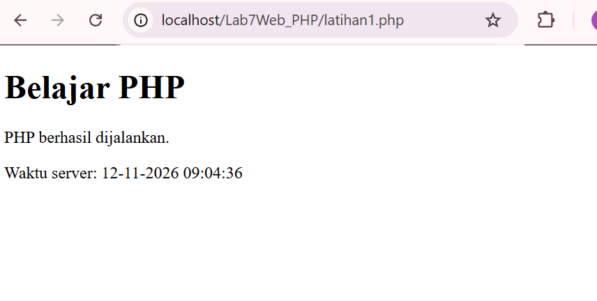
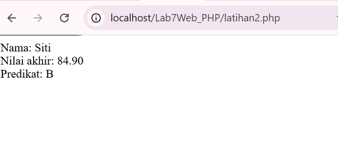
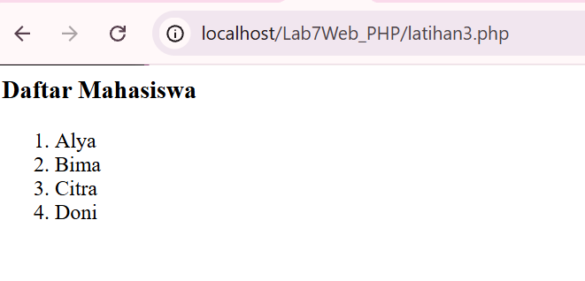
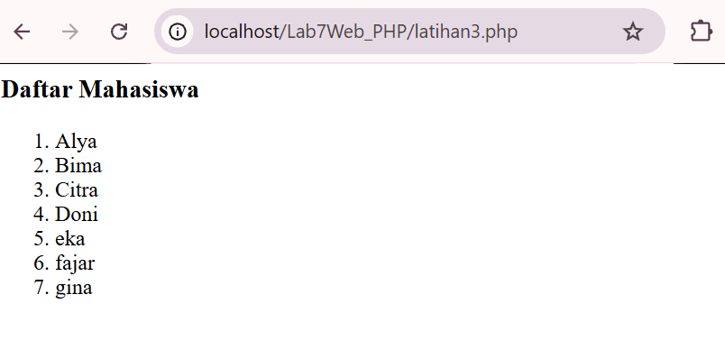
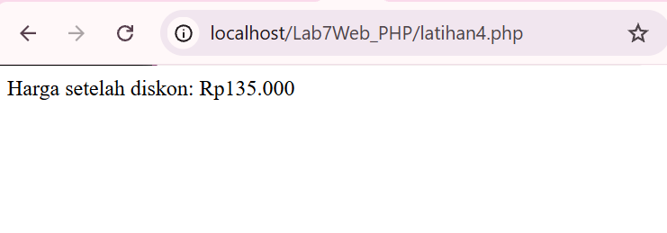
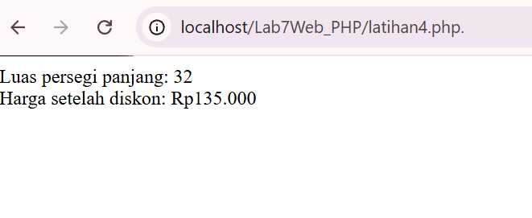
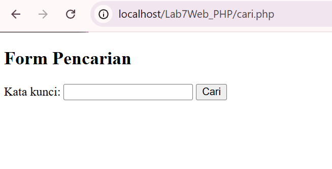
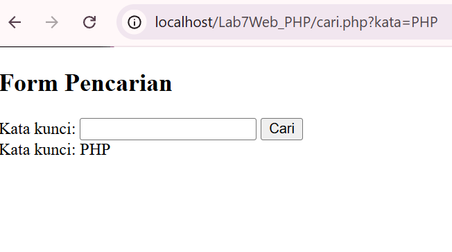

# Lab7Web.

# LAPORAN PRAKTIKUM 7 – PEMROGRAMAN WEB

## 1. Identitas Mahasiswa

- **Nama:** Isnaini
- **NIM:** 312510380
- **Program Studi:** Teknik Informatika
- **Mata Kuliah:** Pemrograman Web
- **Praktikum:** Praktikum 7 – PHP Server-Side Programming

## 2. Tujuan Praktikum

Praktikum ini bertujuan untuk memahami dasar pemrograman PHP sebagai bahasa pemrograman server-side. Melalui praktikum ini, mahasiswa belajar menggunakan variabel, operator, percabangan, perulangan, array, function, serta mengolah data menggunakan metode GET dan POST.

Selain itu, praktikum ini juga bertujuan untuk memahami validasi data dan menampilkan data dengan aman menggunakan PHP.

## 3. Software yang Digunakan

- XAMPP sebagai server lokal.
- Apache untuk menjalankan PHP.
- Visual Studio Code sebagai editor kode.
- Google Chrome sebagai browser.
- PHP sebagai bahasa pemrograman server-side.

## 4. Langkah-Langkah Praktikum

### A. Persiapan

Membuat folder proyek bernama `Lab7Web_PHP` di dalam folder `htdocs` XAMPP. Selanjutnya, folder proyek dibuka menggunakan Visual Studio Code.

### B. Latihan 1 – Menjalankan PHP

Membuat file `latihan1.php` untuk menampilkan teks dan tanggal atau waktu dari server.

### C. Latihan 2 – Variabel, Operator, dan Percabangan

Membuat program untuk menghitung nilai akhir mahasiswa berdasarkan nilai tugas, UTS, dan UAS. Program juga menentukan nilai huruf berdasarkan hasil perhitungan.

### D. Latihan 3 – Array dan Perulangan

Membuat array yang berisi nama mahasiswa dan menampilkan seluruh data menggunakan perulangan `foreach`.

### E. Latihan 4 – Function

Membuat fungsi `hitungDiskon()` untuk menghitung harga setelah diskon dan fungsi `hitungLuas()` untuk menghitung luas persegi panjang.

### F. Latihan 5 – Form GET

Membuat form pencarian menggunakan metode GET. Data pencarian dikirim melalui URL dan ditampilkan kembali menggunakan PHP.

### G. Latihan 6 – Form POST

Membuat form data mahasiswa yang berisi nama dan program studi. Data dikirim menggunakan metode POST dan diperiksa sebelum ditampilkan.

### H. Latihan 7 – Mengolah Data Barang

Membuat form pembelian barang untuk memasukkan nama barang, harga, dan jumlah. Program menghitung subtotal berdasarkan harga dikalikan jumlah barang.

### I. Mini Project – Form Data Mahasiswa

Membuat form pendaftaran mahasiswa dengan data:
- Nama lengkap
- NIM
- Program studi
- Semester
- Email

Program menggunakan metode POST, melakukan validasi data, dan menampilkan hasil apabila seluruh data memenuhi ketentuan.

Validasi dilakukan untuk memastikan kolom wajib diisi, semester berada pada rentang 1–14, dan format email benar.

### J. Eksperimen Tambahan

Eksperimen tambahan yang telah dikerjakan:

1. Menghitung rata-rata dari tiga nilai.
2. Melakukan pencarian nama mahasiswa menggunakan GET.
3. Mengubah format angka menjadi mata uang Rupiah.
4. Melakukan validasi NIM agar hanya berisi angka dan terdiri dari 9 digit.

## 5. Hasil Pengujian

Pengujian dilakukan menggunakan browser melalui server lokal XAMPP.

| No. | Pengujian | Hasil |
|---|---|---|
| 1 | Menjalankan PHP | Berhasil |
| 2 | Menghitung nilai akhir | Berhasil |
| 3 | Menampilkan array mahasiswa | Berhasil |
| 4 | Menghitung diskon dan luas | Berhasil |
| 5 | Mengirim data GET | Berhasil |
| 6 | Mengirim data POST | Berhasil |
| 7 | Menghitung subtotal barang | Berhasil |
| 8 | Form data mahasiswa valid | Berhasil |
| 9 | Validasi semester dan email tidak valid | Berhasil |
| 10 | Menghitung rata-rata | Berhasil |
| 11 | Pencarian nama mahasiswa | Berhasil |
| 12 | Format Rupiah | Berhasil |
| 13 | Validasi NIM | Berhasil |

### Contoh Kasus Valid

1. Form mahasiswa diisi dengan data lengkap, semester 3, dan email dengan format yang benar. Data berhasil ditampilkan.
2. Form pembelian diisi dengan nama barang Buku PHP, harga Rp50.000, dan jumlah 2. Hasil subtotal adalah Rp100.000.

### Contoh Kasus Tidak Valid

1. Form mahasiswa diisi dengan semester 20 dan email `isnaini@gmail`. Sistem menampilkan pesan kesalahan karena semester dan format email tidak valid.
2. Form validasi NIM diisi dengan data yang tidak memenuhi ketentuan angka dan panjang 9 digit. Sistem menampilkan pesan kesalahan.

## 6. Dokumentasi Screenshot

Screenshot hasil praktikum disimpan di folder `screenshots`.

### Latihan 1 – Menjalankan PHP

### Latihan 2 – Variabel dan Percabangan

### Latihan 3 – Array dan Perulangan

### Latihan 4 – Function

### Latihan 5 – Form GET

### Latihan 6 – Form POST

### Latihan 7 – Menghitung Subtotal Barang

### Mini Project – Form Mahasiswa Berhasil

### Mini Project – Pengujian Data Tidak Valid

### Eksperimen 1 – Menghitung Rata-Rata

### Eksperimen 2 – Pencarian GET

### Eksperimen 3 – Format Rupiah

### Eksperimen 4 – Validasi NIM

## 7. Kesimpulan

Berdasarkan Praktikum 7, dapat disimpulkan bahwa PHP dapat digunakan untuk mengolah data pada sisi server dan menghasilkan halaman web yang dinamis. Melalui latihan dan mini project, saya telah mempelajari penggunaan variabel, operator, percabangan, perulangan, array, function, serta pengolahan data menggunakan metode GET dan POST.

Praktikum ini juga memberikan pemahaman mengenai pentingnya validasi data dan penggunaan `htmlspecialchars()` untuk membantu menjaga keamanan ketika menampilkan input pengguna.

Dengan menyelesaikan seluruh latihan dan eksperimen, saya menjadi lebih memahami dasar pemrograman PHP dan cara menjalankannya menggunakan server lokal XAMPP.

---

**Praktikum 7 – Pemrograman Web**  
**Teknik Informatika**
